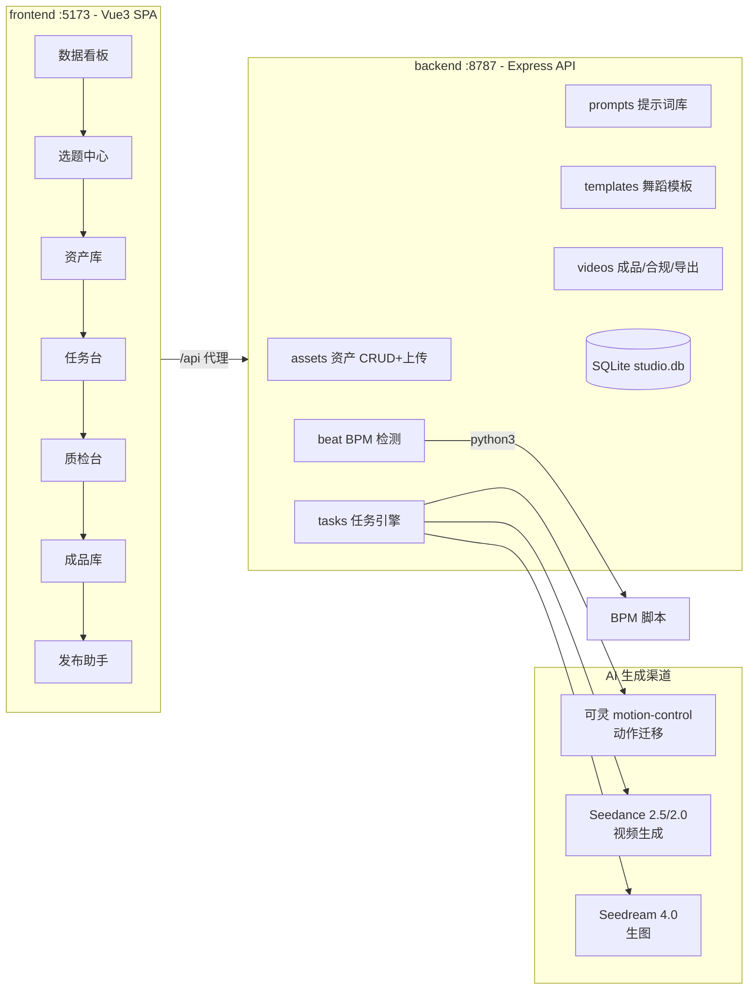

# AI 热门卡点舞生产工作台 · 项目交接文档

> 项目名：**ai-dance-studio**（AI 卡点舞生产工作台）
> 交接日期：2026-10-21（初版 2026-10-13，随后续迭代更新）
> 当前状态：**本地完整可用 + Vercel 线上已上线**；GitHub 仓库 `JasonWaker/ai-dance-studio`（main 分支 11 次提交）已推送，git-connect 自动部署已打通

---

## 1. 项目概览

抖音「AI 美女卡点舞」账号的内部生产系统：从**选题 → 资产 → 生成 → 质检 → 成片 → 发布合规检查**的全流程工作台，已接入真实 AI 生成能力。

**核心生成能力（实战方法论已内置）：**

| 能力 | 说明 | 渠道 |
|---|---|---|
| 动作迁移（换人不换动作） | 模特定妆图 + 参考舞蹈视频 → 保持同一套动作、替换人物形象 | 可灵 motion-control（官方动作迁移） |
| 音乐驱动（BGM 自动编舞） | 音频条件驱动，角色跟随音乐重音自动编排舞蹈 | Seedance 2.5（原生 audio_url 条件） |
| 舞蹈模板直出（最省钱） | **舞蹈名当 prompt**：巴提巴提/科目三/擦玻璃等 10 个热门舞蹈模板已入库 | Seedance（2.0 mini 默认，5s ≈ ¥2.5） |
| 定妆图一致性 | Seedream 生图做定妆图，后续图生图保持长相/服装/场景一致 | Seedream 4.0 |
| BPM 卡点 | 上传舞源/音乐自动检测 BPM 与重音时间戳（纯 PyAV，不依赖 ffmpeg） | 自研脚本 |

**业务边界（重要）**：仅做 AI 虚拟形象 / 舞蹈欣赏 / 穿搭展示 / 健身向内容；**禁止真人、名人肖像**（AI 换脸属侵权红线，黄仁勋/马斯克类恶搞已明确拒绝支持）。

---

## 2. 技术栈与架构

### 2.1 技术栈

| 层 | 技术 |
|---|---|
| 前端 | Vue 3 + Vite 6.4.4 + Element Plus + Pinia + vue-router（hash 路由） |
| 后端 | Node.js（ESM）+ Express + better-sqlite3（SQLite）+ multer（上传）+ uuid |
| AI 适配 | 火山方舟（Seedance 视频 / Seedream 生图）、可灵 Kling（动作迁移）、即梦（预留） |
| 音频处理 | Python3 + PyAV + NumPy（BPM 检测脚本） |
| 部署 | Vercel（services 模式：前端静态 + Express serverless） |
| 工程 | npm workspaces monorepo |

### 2.2 架构与数据流



**生成链路（核心）**：任务台创建任务 → 任务引擎（内存队列，顺序执行）→ 按模型版本路由到对应 provider → 真实 API 异步创建任务并轮询 → 成功后写回 task 结果 + 生成 video 成品记录（待质检）→ 质检通过进成品库 → 合规预检 → 发布。

**无密钥 / MOCK_MODE=true 时自动进入模拟生成**（全流程可演示，不消耗 API 额度）。

**素材格式处理（可灵动作迁移的关键坑，已踩平）**：
- 可灵 `image_url`：支持**纯 base64**（不带 `data:` 前缀）或公网 URL → 系统对本地形象图自动转 base64
- 可灵 `video_url`：**只支持公网 URL，不支持 base64** → 系统对本地舞源视频自动经线上 Vercel 中转（`KLING_RELAY_URL` + `UPLOAD_TOKEN` 鉴权）上传后拿公网链接

---

## 3. 目录结构与代码说明

```
ai-dance-studio/
├── package.json              # monorepo 根（workspaces: backend + frontend）
├── vercel.json               # Vercel services 部署配置
├── .gitignore                # 已排除 .env / data / uploads / node_modules / dist 等
├── README.md                 # 快速上手
├── start-local.sh            # ★ 一键启动脚本（幂等：端口占用自动跳过，拉起前后端）
├── 项目交接文档.md            # 本文档
│
├── backend/                  # 后端（Express + SQLite）
│   ├── package.json
│   ├── .env                  # ★ 真实密钥（不入仓库）
│   ├── .env.example          # 密钥配置模板
│   └── src/
│       ├── index.js          # Express 入口：路由挂载 + /uploads 静态 + export default app（Vercel 兼容）
│       ├── db.js             # SQLite 建表 + 种子数据（提示词/话题/模板/舞蹈模板）+ remark 迁移
│       ├── compliance.js     # 合规检查器（违禁词 + 发布清单）
│       ├── ai/
│       │   ├── providers.js  # 统一生成入口：按模型版本路由 + mock 降级
│       │   ├── seedance.js   # 火山方舟适配器（Seedance 视频异步轮询 + Seedream 生图/图生图；mini 不支持视频参考会拦截提示）
│       │   ├── kling.js      # 可灵动作迁移适配器（形象图 base64 + 视频公网 URL 中转 + 异步轮询）
│       │   └── jimeng.js     # 即梦适配器（预留，需配置 BASE_URL）
│       ├── engine/
│       │   └── taskEngine.js # 任务引擎：内存队列 + 状态机 + prompt 组装 + motion 前置校验 + 质检
│       ├── routes/           # REST 路由（见第 6 节 API 清单）
│       └── beat/
│           ├── index.js      # BPM 检测封装（spawn python3）
│           └── bpm_detect.py # PyAV 自相关 BPM + 重音时间戳（不依赖 ffmpeg）
│
├── frontend/                 # 前端（Vue3 SPA，hash 路由）
│   ├── vite.config.js        # /api、/uploads 代理到 :8787
│   ├── index.html
│   └── src/
│       ├── main.js           # Element Plus + 全量图标注册
│       ├── router/index.js   # 8 个页面路由
│       ├── api/index.js      # axios 封装 + 各业务 API 模块
│       └── views/            # Dashboard / Topics / Assets / Tasks / Review / Prompts / Videos / Publish
│
└── vercel/
    └── api/index.js          # Vercel Serverless 入口（import backend app）
```

---

## 4. 环境准备与本地运行

### 4.1 前置依赖

- **Node.js ≥ 20**（开发环境 22）
- **Python3**（BPM 检测用）+ pip 包：`av`（PyAV）、`numpy`
- npm（workspaces）

### 4.2 密钥配置（backend/.env，不入仓库）

从 `.env.example` 复制，填入真实密钥：

| 字段 | 说明 | 当前值 |
|---|---|---|
| `ARK_API_KEY` | 火山方舟密钥（Seedance 视频 + Seedream 生图） | 已配置（本地） |
| `ARK_BASE_URL` | 方舟 API 地址 | `https://ark.cn-beijing.volces.com/api/v3` |
| `SEEDANCE_MODEL` | Seedance 模型 ID | `doubao-seedance-2-5-260628` |
| `SEEDREAM_MODEL` | Seedream 模型 ID | `doubao-seedream-4-0-20260415` |
| `KLING_API_KEY` | 可灵密钥（动作迁移） | 已配置（本地） |
| `KLING_BASE_URL` | 可灵 API 地址 | `https://api-beijing.klingai.com` |
| `KLING_RELAY_URL` | 可灵视频中转（公网 URL 服务） | `https://ai-dance-studio.vercel.app` |
| `UPLOAD_TOKEN` | 中转上传鉴权 token（本地与线上必须一致） | 已配置（本地 + Vercel Secret） |
| `JIMENG_API_KEY` / `JIMENG_BASE_URL` | 即梦（可选，未启用） | 空 |

**模型 ID 官方映射**（`seedance.js` 内 `MODEL_MAP`）：

| 版本 | 模型 ID | 时长上限 |
|---|---|---|
| Seedance 2.5 | `doubao-seedance-2-5-260628` | 4–30s |
| Seedance 2.0 | `doubao-seedance-2-0-260128` | 4–15s |
| 2.0 fast | `doubao-seedance-2-0-fast-260128` | 4–15s |
| 2.0 mini（最省钱） | `doubao-seedance-2-0-mini-260615` | 4–15s |
| Seedream 4.0 | `doubao-seedream-4-0-20260415` | 生图 |

> 若账号模型 ID 不同，以火山方舟控制台「开通管理」为准，覆盖 `.env` 即可。

### 4.3 启动命令

```bash
cd ai-dance-studio
npm install                    # monorepo 一次性装依赖

# 方式一：一键启动（推荐，幂等，重启电脑后只需跑这个）
./start-local.sh               # 后端 :8787 + 前端 :5173 自动拉起，已在运行的端口会跳过

# 方式二：分别启动（推荐调试）
npm run dev -w backend         # 后端 :8787（node --watch）
npm run dev -w frontend        # 前端 :5173 → http://localhost:5173
```

**验证**：浏览器打开 `http://localhost:5173`；后端健康检查 `http://localhost:8787/api/health`（返回 providers 配置状态与 mockMode）。

---

## 5. 系统能力详解

### 5.1 工作台 8 个页面

| 页面 | 路由 | 作用 |
|---|---|---|
| 数据看板 | `/dashboard` | 任务/成片统计、渠道密钥状态 |
| 选题中心 | `/topics` | 官方话题列表（#AI卡点魔性跳舞 等）、选题灵感 |
| 资产库 | `/assets` | 模特 / 造型 / 场景 / 舞源 / 音乐五类资产，上传自动测 BPM；**全部支持编辑 + 备注** |
| 任务台 | `/tasks` | **核心页面**：动作迁移 / 音乐驱动 / 舞蹈模板直出 / 生图 / 换装；💡 词库弹窗、成本预估、新增舞蹈入库、prompt 回溯 |
| 质检台 | `/review` | 预览生成结果，通过 → 成品库 / 重做 |
| 提示词中心 | `/prompts` | 分类提示词库（造型/场景/动作/运镜/风格/文案）+ 随机灵感 + 热度统计 |
| 成品库 | `/videos` | 已通过质检的成片：合规预检、批量导出、平台数据回填 |
| 发布助手 | `/publish` | 发布合规清单 + 文案违禁词检测 |

### 5.2 任务类型（5 种）

| type | 含义 | 走哪个渠道 | 注意 |
|---|---|---|---|
| `motion` | 动作迁移（换人不换动作） | 可灵 motion-control（imageRef + videoRef 必填） | **默认模型自动选可灵 kling-v2-6**；模特必须有形象图、舞源必须有视频（前端已禁用不满足的选项，后端有精准提示） |
| `music_drive` | 音乐驱动（BGM 自动编舞） | Seedance 2.5（audioRef + 图参考） | 选音乐资产 |
| `dance` | **舞蹈模板直出**（舞蹈名当 prompt） | Seedance（默认 2.0 mini，最省钱） | 选舞蹈模板 |
| `image` | 生图（定妆图） | Seedream 4.0（文生图/图生图） | 默认模型自动选 Seedream 4.0 |
| `outfit` | 换装 | Seedream（图生图保持长相） | 默认模型自动选 Seedream 4.0 |

**舞蹈模板直出要点**：前端可随时新增舞蹈入库（`TemplatesApi.create`），**舞蹈名越火，Seedance 跳得越准**——已预置：巴提巴提舞、科目三、擦玻璃舞、摆摆舞、手势舞、摇花手、抖肩舞、韩舞女团、Jazz 爵士、螃蟹舞。

**prompt 回溯**：任务详情可查看送 AI 的完整 prompt 并复制存档，用于复现与调优。

### 5.3 BPM 卡点检测

- 上传舞源/音乐 → `POST /api/beat` → 返回 `{ bpm, duration, beats[] }`
- 纯 Python（PyAV 解码 + 自相关估计 + 能量峰值重音），**不依赖 ffmpeg/ffprobe**
- BPM 检测范围 60–200，自动防半速/双速误判

### 5.4 合规检查（内置，务必遵守）

发布前检查清单（`/api/videos/compliance-check` + 发布助手页）：

1. 画面前 5 秒标注「本视频含 AI 生成内容」
2. 发布页勾选 AI 生成标签（未标注会被限流 50%–80%）
3. 无真人面容/未授权肖像（AI 换脸属侵权红线）
4. 无低俗擦边动作/文案/暗示（平台已点名打击「魅惑舞蹈」）
5. 无水印、无违禁词
6. 非批量搬运同质化
7. 舞源/音乐版权来源合规

---

## 6. API 清单

Base：`/api`，响应均为 JSON。

| 方法 | 路径 | 说明 |
|---|---|---|
| GET | `/health` | 健康检查 + providers 配置状态 + 合规清单 |
| POST | `/assets/upload` | 上传素材文件（multipart）→ `/uploads/...`（带 `X-Upload-Token` 中转鉴权，浏览器上传不受影响） |
| GET/POST | `/assets/{models\|outfits\|scenes\|danceSources\|music}` | 资产五类 CRUD（含 remark 备注字段） |
| PUT/DELETE | `/assets/{key}/:id` | 资产更新/删除 |
| GET | `/prompts` | 提示词列表（category/keyword 筛选，按热度） |
| GET | `/prompts/categories` | 提示词分类 |
| GET | `/prompts/random` | 随机灵感（category + count） |
| POST | `/prompts` | 新增提示词 |
| POST | `/prompts/:id/use` | 使用计数 +1 |
| DELETE | `/prompts/:id` | 删除提示词 |
| GET | `/templates` | 模板列表（可按 type 筛选，enabled=1） |
| GET | `/templates/types` | 模板类型 |
| POST | `/templates` | 新增模板（舞蹈模板入库） |
| DELETE | `/templates/:id` | 删除模板 |
| GET | `/topics` | 官方话题列表（按热度排序） |
| GET | `/tasks` | 任务列表（limit） |
| POST | `/tasks` | 创建任务（type: motion/music_drive/dance/image/outfit） |
| GET | `/tasks/:id` | 任务详情（含 result_url、error、prompt 回溯） |
| POST | `/tasks/:id/review` | 质检（action: pass/redo） |
| GET | `/videos` | 成品列表（status 筛选） |
| POST | `/videos/compliance-check` | 合规预检 |
| POST | `/videos/export` | 导出（生成 export_record，返回文件 URL 列表） |
| GET | `/videos/exports` | 导出记录 |
| PUT | `/videos/:id/stats` | 平台播放/点赞数据回填 |
| POST | `/beat` | 上传媒体检测 BPM + 重音时间戳 |

---

## 7. 数据模型（SQLite：backend/data/studio.db）

| 表 | 用途 | 关键字段 |
|---|---|---|
| `model` | 模特 | name, face_seed, style_prompt, ref_image, **remark** |
| `outfit` | 造型 | name, image, style_tag, **remark** |
| `scene` | 场景 | name, type, ref_image, description, **remark** |
| `dance_source` | 舞源 | name, video_url, duration_s, bpm, genre, hot_score, music_id, **remark** |
| `music` | 音乐 | name, audio_url, bpm, style, copyright, **remark** |
| `prompt_library` | 提示词库 | category, title, content, tags, hot_count |
| `template` | 任务模板 | type, name, params(JSON), prompt, enabled |
| `topic` | 话题 | name, hot_score, enabled |
| `task` | 生成任务 | type, status, 各资产外键, model_version, params, result_url, credit_cost, error |
| `video` | 成品 | task_id, file_url, resolution, bpm, compliance, publish_status, 播放/点赞 |
| `export_record` | 导出记录 | video_ids, format, resolution, status, zip_url |
| `batch` | 批量生产（预留） | batch_date, target_count, produced_count, hit_count |

种子数据（首次启动自动写入）：20 条提示词、4 条话题、6 条任务模板 + 10 条舞蹈模板（幂等补种）。**remark 列迁移在建表之后执行，空库冷启动不报错**（此为线上 serverless 崩溃修复点，勿把迁移挪到建表前）。

---

## 8. 部署状态（2026-10-21）

### 8.1 Vercel（已上线 ✅，已修复全部线上问题）

- **线上地址**：https://ai-dance-studio.vercel.app
- **架构**：Vercel services 模式——`vercel.json` 定义两个 service：
  - `frontend`（root: frontend/，Vite 构建 → dist 静态）
  - `backend`（root: backend/，Express entrypoint `src/index.js` → serverless function，maxDuration 60s）
  - 顶层 rewrites：`/api/*` → backend，其余 → frontend
- **生产环境变量（Vercel 控制台 / CLI 已配置为 Secret）**：

| 变量 | 值 |
|---|---|
| `ARK_API_KEY` | 火山方舟密钥 |
| `KLING_API_KEY` | 可灵密钥 |
| `ARK_BASE_URL` | `https://ark.cn-beijing.volces.com/api/v3` |
| `SEEDANCE_MODEL` | `doubao-seedance-2-5-260628` |
| `SEEDREAM_MODEL` | `doubao-seedream-4-0-20260415` |
| `DATA_DIR` | `/tmp/studio-data` |
| `UPLOAD_DIR` | `/tmp/uploads` |
| `UPLOAD_TOKEN` | 中转上传鉴权 token（与本地 .env 一致） |

- **部署链路**：GitHub `JasonWaker/ai-dance-studio` main 分支 → git-connect 自动部署（push 即发布）

### 8.2 GitHub（已推送 ✅）

- 仓库：**JasonWaker/ai-dance-studio**，main 分支，11 次提交
- 推送方式：fine-grained PAT 命令行 `git push https://x-access-token:<PAT>@github.com/JasonWaker/ai-dance-studio.git main:main`（GitHub MCP 写通道当时不可用）
- ⚠️ **安全提醒**：曾使用的 PAT 明文出现在对话中，若未吊销请尽快在 GitHub 撤销并重新生成（生成后同步更新 git remote）

### 8.3 线上问题修复记录（重要，避免回退）

| 问题 | 根因 | 修复 |
|---|---|---|
| 线上资产库页面空白/渲染崩溃 | 前端 `cur.conf.xxx` 访问不存在字段（应为 `cur.xxx`）；Vite 6.0.x helper 文件命名不一致 404 | 修正源码 3 处 + 升级 **Vite 6.4.4** 重构建 |
| 本地页面空白需刷新 | vite dev 旧进程与文件不一致 / 只监听 IPv6 | 重启 + 显式 `--host 127.0.0.1`；`start-local.sh` 一键拉起 |
| 资产库保存报 500 | 名称 NOT NULL 未校验 | 后端 400 友好校验 + 前端提示 |
| 生图任务无 Seedream 模型 | 模型下拉缺 Seedream、image 类型误选视频模型 | 补 Seedream 4.0 + onTypeChange 自动切换 |
| 动作迁移 400 失败 | **Seedance 2.0 mini/fast 不支持视频参考** | 前端动作迁移隐藏 mini/fast、默认可灵；后端拦截 + 友好提示 |
| 动作迁移缺素材报错 | 模特无形象图 / 舞源无视频 | 前端禁用不满足项（标注「未上传视频/无形象图」）+ 后端精准提示 |
| 可灵 500（code 1201/1200） | 素材格式：图片必须 base64、**视频必须公网 URL** | kling.js 图片自动 base64 + 视频自动经 Vercel 中转（UPLOAD_TOKEN 鉴权） |
| **线上所有 API 500（函数崩溃）** | **db.js 建表前执行 ALTER 迁移，空库冷启动报 `no such table` 崩溃** | 迁移移到建表之后；上传目录 mkdir 预建 |

---

## 9. 已知问题与限制

| 问题 | 影响 | 建议 |
|---|---|---|
| **serverless 数据不持久**：Vercel 函数实例的 SQLite/上传文件在临时盘（/tmp），多实例隔离、冷启动清空 | 线上创建任务/上传素材可能因实例切换"丢失"；种子数据每实例自动重建 | 线上版定位为**演示体验 + 可灵视频中转**；**正式批量生产用本地运行版**，或后续接入外部数据库（Vercel Postgres/KV） |
| **可灵视频中转依赖 Vercel /tmp**：中转上传的视频文件可能被冷启动清理 | 若舞源 URL 生成任务时失效会失败 | 系统按任务实时上传（URL 新鲜够用）；舞源要长期复用建议后续接对象存储 |
| **函数超时**：Seedance 轮询最长 240s > Vercel 函数上限 60s | 线上超长生成任务（>1 分钟）可能超时报错 | 线上跑短任务；长任务用本地版 |
| **可灵动作迁移真实链路只在本轮打通**：历史上 kling-v1"已通过"是 mock 记录，非真实生成 | 以本次 base64+中转方案为准 | 首次真实生成时观察任务状态，确认扣费与出片 |
| **multer 1.x 存在已知漏洞**（npm 构建告警） | 安全提示 | 后续升级 multer 2.x |
| GitHub PAT 明文暴露 | 安全隐患 | 见 8.2 安全提醒 |

---

## 10. 交接 Checklist（接手人必做）

- [ ] 本地 `npm install` + 配置 `backend/.env`（复制 .env.example 填密钥，**含 UPLOAD_TOKEN**，需与线上一致）→ `./start-local.sh` 双端启动验证
- [ ] 确认 `python3 -c "import av, numpy"` 可运行（BPM 检测依赖）
- [ ] 真实生成冒烟：任务台建一个「舞蹈模板直出（科目三，2.0 mini）」，观察 60s 内出片
- [ ] 动作迁移冒烟：选有形象图的模特 + **有视频的舞源**（如猫咪/闪身步/batibati），模型自动可灵 kling-v2-6，验证真实生成
- [ ] 确认 `.env` 未被提交（git status / 仓库检查）
- [ ] 线上验证：https://ai-dance-studio.vercel.app 首页 + `/api/health` + 一次短任务生成
- [ ] 如需正式生产：接入外部数据库，将任务引擎改为持久化队列 + 前端轮询

---

## 11. 后续规划建议（未实施）

- **并发队列**：任务引擎当前为内存顺序队列（单进程），本地多任务需升级持久化队列（BullMQ/Redis）或并发 worker
- **对象存储**：舞源/形象图接入 OSS/COS，替代 Vercel /tmp 中转，解决素材持久性（可灵视频 URL 永久可用）
- **卡点剪辑引擎**：模板中的「剪辑/结构」类型已预留，尚未实现真实 FFmpeg 卡点合成（可接入 byted-mediakit-editing 能力）
- **批量生产**：`batch` 表已建，可做"一批 10 条"批量任务 + 自动数据回填
- **账号矩阵**：多账号发布管理、排期表
- **数据看板**：接入抖音开放平台真实播放/点赞数据

---

*文档由开发过程沉淀整理，代码为准。有出入处请以仓库代码为准。*
